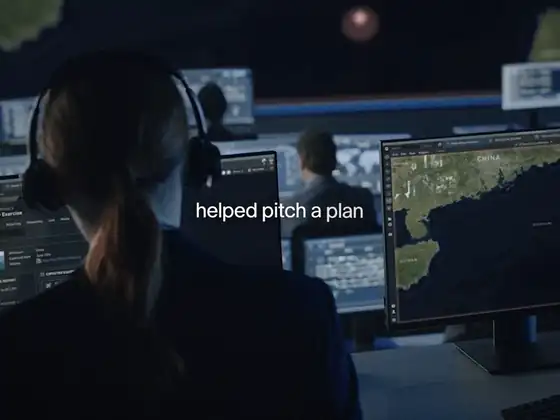
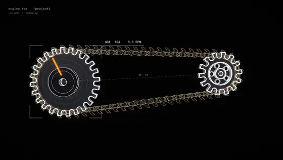
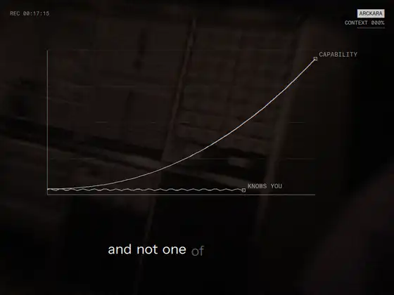
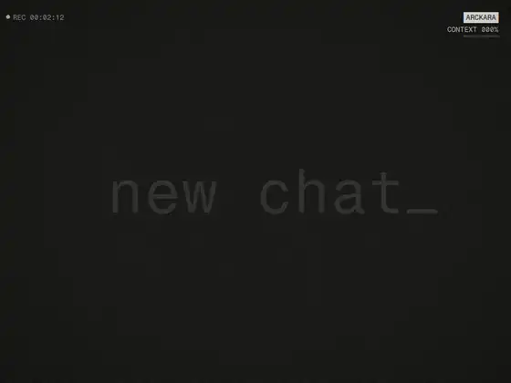

# Claude Video Kit

Agents and skills that let Claude Code edit video and make motion films in code: real footage, real fonts, words timed to the voice, cuts on the music's beat, measured sound. The baseline is neutral and human. Nothing should look like a template, a slideshow or a generated video.

Clone it, open it in Claude Code, and ask for an edit.

## Examples

Silent excerpts from films made with these agents and skills: brand films, a narrated story reel and a fan edit. Credits: [docs/examples/CREDITS.md](docs/examples/CREDITS.md).

<table>
<tr>
<td colspan="3" width="50%" valign="top"><br><b>Story reel</b><br>A true story told over real footage: headlines pushed in with the key phrase highlighted as it is said, counts and big words on the beat. <code>story-reel</code></td>
<td colspan="3" rowspan="2" width="50%" valign="top"><br><b>UI motion</b><br>The product's interface rebuilt in HTML, animated as a pure function of time, captured frame by frame. <code>ui-motion</code></td>
</tr>
<tr>
<td colspan="3" valign="top"><br><b>Anime edit</b><br>A trend sound edit: gears built up and meshing on the beats, anime and manga layered through them, impact frames on every hit. <code>motion-craft</code></td>
</tr>
<tr>
<td colspan="2" width="33%" valign="top"><br><b>Voice led fast cut</b><br>Takes cut to the voice's words and the music's beats; big type, a graph, the voice's waveform, microscopy. <code>cutfilm</code></td>
<td colspan="2" width="33%" valign="top"><br><b>Slow story</b><br>Public domain archive film, words centred and fading in as they are said, a typed record card. <code>specfilm</code></td>
<td colspan="2" width="33%" valign="top"><br><b>Spec sheet</b><br>Typed mono, boxes that re-flow between layouts, counters over real footage. <code>specfilm</code></td>
</tr>
</table>

## What it makes

- Captioned talking head videos, vlogs and interviews, in any language, including speech that switches languages mid sentence
- Clean screen recorded demos, with private data blurred
- Narrated story reels: a voice tells a true story over real footage, headlines and photos
- Voice led brand and launch films, spec sheet films, music cut montages, kinetic type, particle and letter field films
- Product UI motion: interface moments rebuilt in HTML and rendered frame by frame
- Contact sheets and a measured QA report for every master

## How it works

Three agents, each with a clear job:

- **motion-director** decides what a film is: the idea, the beats, and a simple flow doc (Text / Screen / Motion for each scene). It also reviews cuts.
- **motion-designer** builds the film: sources footage, writes a small builder script, renders stills, a preview and the master, and proves it with measurements.
- **video-editor** handles recorded video: captions, cleanup cuts, screen demos.

Nine skills hold the know how:

- **film-taste**: the baseline. What makes an edit look made by a person, and the tells that make it look generated.
- **motion-craft**: timing, spacing, easing and the film grammar of a trailer editor.
- **brand-motion**: the render engines (Python and ffmpeg) and how to drive them.
- **ui-motion**: product interface animation as HTML scenes, captured frame by frame in headless Chrome.
- **story-reel**: narrated story videos, from script and voice to master, plus versions in other languages.
- **captions**: measured pauses, local Whisper word timings, phrase aware line breaks, per script fonts.
- **footage-sourcing**: where real footage comes from, licences, and a provenance record per shot.
- **music-and-mix**: picking music by structure, the vocal check, the beat grid, voice, effects restraint, loudness, endings.
- **video-qa**: contact sheets, face under type checks, loudness and tail checks, flashes, duplicates.

`CLAUDE.md` holds the house rules every session starts with.

## Quick start

1. Follow [SETUP.md](SETUP.md) (ffmpeg, Python, Node; about 15 minutes).
2. `python tools/check_setup.py`
3. Optional: set up your fonts and logo in `brand/` ([brand/README.md](brand/README.md)).
4. Open the folder in Claude Code and ask.

Things to ask:

- "Caption this clip: `path/to/clip.mp4`. Two lines max, nothing on my face."
- "Cut the dead air and false starts out of this recording, keep my voice untouched."
- "Turn this screen recording into a clean demo and blur anything private."
- "Make a 75 second story reel about how a company was founded. Write the script first."
- "Here is my voiceover and a track. Cut a 4:3 film on real footage."
- "Direct a 30 second launch teaser for this product, then build it."
- "Animate this screen of our app: a reply arrives, gets approved, the count drops."
- "Review this cut against film-taste and tell me what looks AI."

## The taste, in short

- Real footage, specific to the story, from mixed sources. Never the stock look.
- One face per text position, one size per screen, words fading in as they are said, text that never jumps.
- Cuts on the beat of the song that ships; pace follows the music; hard cuts unless a transition means something.
- An instrumental bed under any voice, checked, not assumed. Sound effects are the exception.
- A real voice stays unprocessed. Loudness measured: -14 LUFS, true peak under -1 dBTP.
- Generated footage only where it ships, inside real footage, labelled.

## Layout

```
CLAUDE.md                 house rules
SETUP.md                  install
brand/                    brand.json, fonts/ and logo/ (fonts and logos are not committed)
projects/                 one folder per film (ignored by git)
tools/check_setup.py      checks the machine
.claude/agents/           motion-director, motion-designer, video-editor
.claude/skills/           film-taste, motion-craft, brand-motion, ui-motion, story-reel,
                          captions, footage-sourcing, music-and-mix, video-qa
docs/examples/            the example clips above
```

## Credits and licence

MIT, see [LICENSE](LICENSE). The motion-craft reference files are adapted from two MIT licensed projects, [motion-design-with-claude-and-codex](https://github.com/LobzyJay/motion-design-with-claude-and-codex) and [LottieFiles' motion-design-skill](https://github.com/LottieFiles/motion-design-skill); their licences are in [licenses/](licenses/).

Fonts, footage, music and logos you use with the kit keep their own licences.
